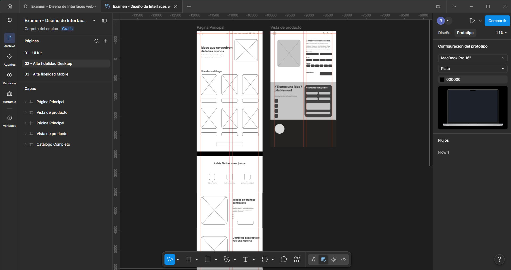
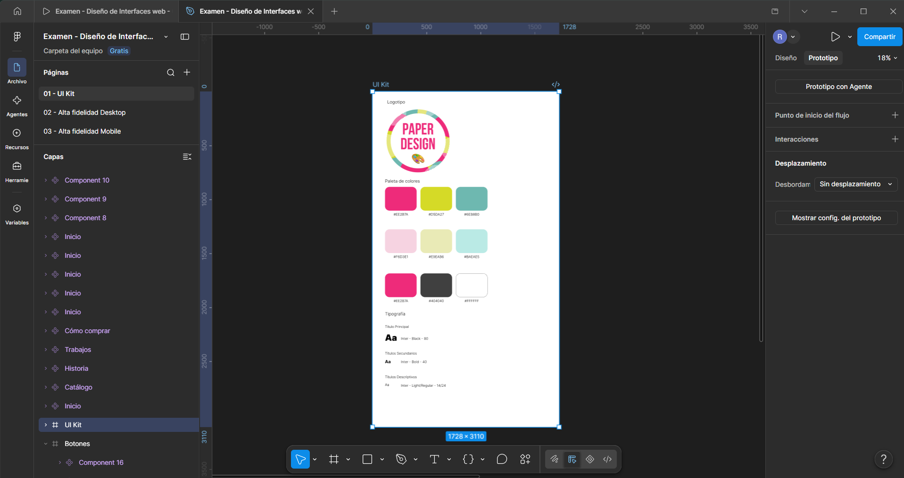
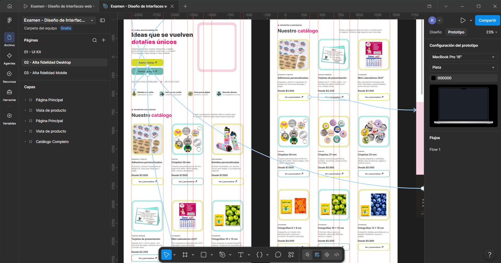
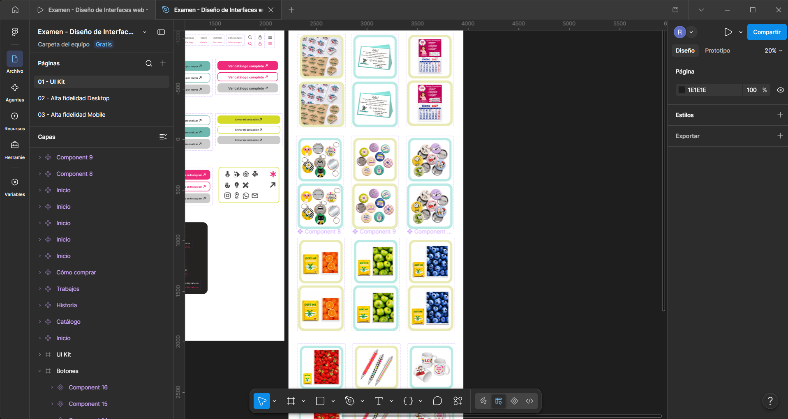
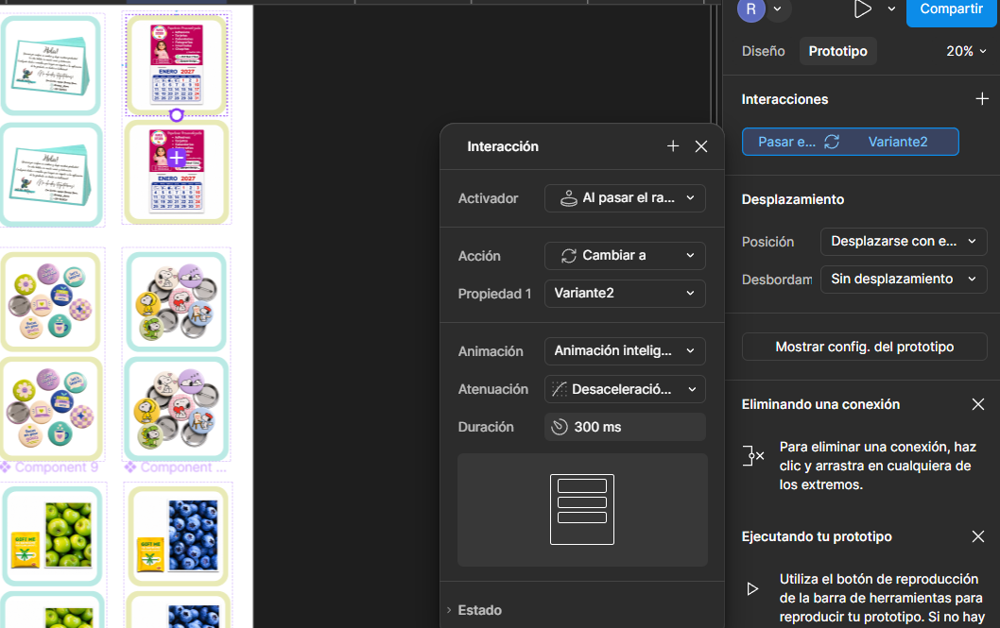
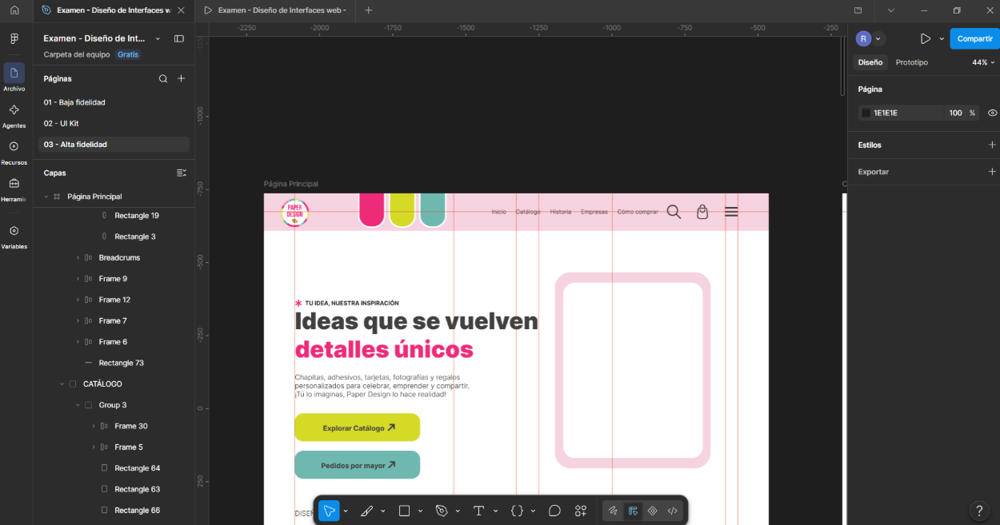
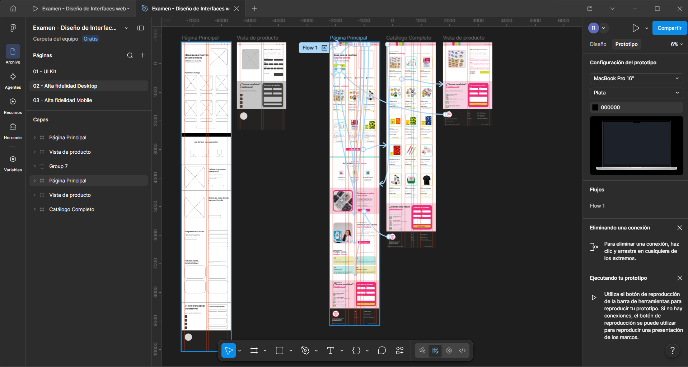
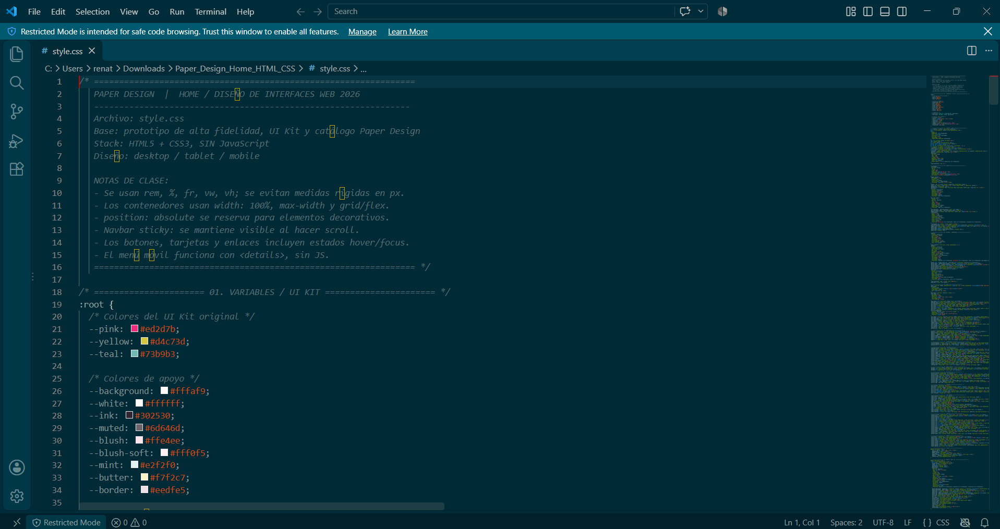
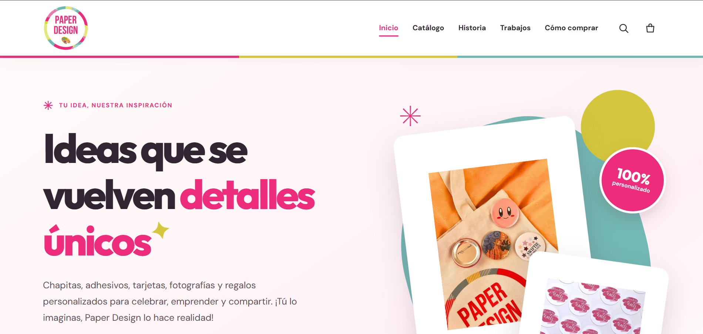

# Renata Arévalo Urra Paper Design - Bitácora de proyecto Examen

Prototipo Figma: https://www.figma.com/design/kMhjW5vmicuQDVx1cX9iJS/Examen---Dise%C3%B1o-de-Interfaces-web?node-id=1-3

GitHub Pages: https://arevalourra.github.io/paper-design/

## Descripción general del proyecto

Este proyecto consiste en el diseño de una **página web tipo catálogo para Paper Design**, un emprendimiento familiar creado en 2020, dedicado a la papelería y los productos personalizados. Entre sus productos se encuentran chapitas, stickers, etiquetas, llaveros y otros artículos gráficos realizados a pedido.

La idea es contar con un espacio digital donde las personas puedan conocer los productos, revisar sus características, tamaños y precios, y consultar por pedidos personalizados de manera sencilla. También me interesa que la página muestre quién está detrás del emprendimiento: actualmente soy estudiante de **Diseño Industrial en la Universidad Diego Portales (UDP)**, y Paper Design ha sido un espacio para desarrollar mi creatividad y aprender nuevas técnicas de producción.

En esta primera etapa estoy explorando referentes de páginas comerciales que me ayuden a visualizar cómo presentar los productos y comunicar la historia de la marca. El diseño se trabajará inicialmente en **Figma, en formato MacBook Pro de 16 pulgadas**.

## Referentes web

### 1. Insumos Más que Papel

**Sitio:** [www.insumosmasquepapel.cl](https://www.insumosmasquepapel.cl/)


De este sitio me gusta su **estética general** y la manera en que organiza la información en las fichas de producto. La fotografía ocupa un espacio importante, mientras que al lado aparecen el nombre, el precio y los botones para seleccionar opciones como cantidad y tamaño. También destaco la navegación por categorías y el buscador.

Lo que más me interesa tomar como referencia es esa **selección de variantes y su relación con el precio**. Para Paper Design sería útil que, por ejemplo, al elegir el tamaño de una chapita y la cantidad solicitada, se pueda visualizar claramente el valor correspondiente. La actualización de precio es una funcionalidad que quisiera explorar en mi propuesta.

### 2. Donna Insumos

**Sitio:** [donnainsumos.cl](https://donnainsumos.cl/)


De esta página me llama la atención principalmente el **footer o pie de página**. Me gusta que esté distribuido en columnas y reúna el logotipo, una breve descripción de la tienda, enlaces a categorías, información de contacto y redes sociales sin verse desordenado.

Tomaría como referencia esta **organización y jerarquía de la información** para el cierre de la web de Paper Design, incorporando los datos de contacto, Instagram, enlaces al catálogo y una breve presentación del emprendimiento.

### 3. Magnéticas

**Sitio:** [www.magneticas.cl](https://www.magneticas.cl/)


De Magnéticas me gusta especialmente la sección **«Quiénes Somos»**. En lugar de limitarse a describir los productos, presenta a la persona detrás del negocio y cuenta cómo surgió la idea. El tono es cercano y personal, y las palabras destacadas en negrita ayudan a dar énfasis al relato.

Me gustaría tomar esta forma de **contar la historia del emprendimiento** para Paper Design: explicar sus inicios como proyecto familiar en 2020, su evolución con el tiempo y mi vínculo actual con el diseño. La intención es que quienes visiten la web no solo vean un catálogo, sino que también conozcan a la persona y la historia detrás de la marca.

---

## Avance del proyecto — Diseño y prototipado en Figma
**16 de Noviembre de 2026**

Después de definir los referentes y la idea general de la página, comencé a trabajar en las primeras maquetas de Figma. Organicé el archivo en tres páginas: UI Kit, alta fidelidad desktop y alta fidelidad mobile, para ir desarrollando el proyecto por etapas y no mezclar todos los elementos.

Primero trabajé la estructura en baja fidelidad, definiendo dónde irían las imágenes, textos, botones y las distintas secciones de la página. Quería que la web no fuera solamente un catálogo, sino que también mostrara un poco de la historia de Paper Design y explicara cómo funciona el proceso de personalización y compra.



Luego comencé a desarrollar el UI Kit utilizando los colores del logotipo, la tipografía Inter, íconos y diferentes estilos de botones. Fui probando distintas combinaciones, pero finalmente mantuve los colores principales de la marca (fucsia, amarillo y turquesa), acompañados de tonalidades pastel y espacios blancos para que la página no se viera tan saturada.




Con esta base avancé al prototipo de alta fidelidad, donde actualmente tengo desarrolladas tres vistas principales: **Página Principal, Catálogo Completo y Vista de producto**, todas en formato MacBook Pro de 16 pulgadas.

Una de las cosas que más tiempo me tomó fue organizar el catálogo, ya que necesitaba mostrar productos bastante diferentes, pero manteniendo una misma estructura visual. Fui ajustando las tarjetas, fotografías, nombres, descripciones y precios para que se vieran ordenados. También tuve que resumir varias descripciones porque inicialmente ocupaban demasiado espacio.

En un comienzo dejé recuadros vacíos para las imágenes, pero posteriormente fui incorporando fotografías de los productos reales de Paper Design. Para esto también trabajé en mejorar las imágenes y sus fondos, buscando que se vieran más profesionales y que mantuvieran una estética similar dentro de la página.

Al avanzar con el diseño, también comencé a utilizar guías y columnas para ordenar los elementos, especialmente en las tarjetas del catálogo y en las secciones que combinan imágenes con textos. Esto me ayudó a mantener una mejor alineación y distribuir los espacios de manera más consistente.




### Algunas dificultades durante el proceso

Cuando comencé a probar las interacciones en Figma me di cuenta de que había varias cosas que no sabía cómo configurar.

Por ejemplo, quería que los botones cambiaran de apariencia cuando el usuario pasara el cursor sobre ellos.

Para esto comencé a trabajar con variantes, creando diferentes estados para un mismo botón. También quise aplicar un efecto similar a las fotografías del catálogo, haciendo que aumentaran ligeramente de tamaño al pasar el cursor sobre ellas, no sabía bien como hacerlo y le consulté a la IA:

> ¿Cómo hago para que al pasar el ratón por sobre la imagen esta tenga un efecto donde crece un poco su tamaño?

```
¡SÍÍÍ, te entendí perfecto! Lo que quieres se llama Zoom on Hover, un efecto donde la imagen aumenta ligeramente de tamaño cuando pasas el cursor sobre ella y vuelve suavemente a su tamaño original cuando lo retiras.

Es ideal para las tarjetas de productos del catálogo de Paper Design, porque les dará un aspecto más interactivo y profesional.
Cómo hacerlo en Figma, paso a paso
1. Crea dos estados de tu imagen
En tu página 02 - UI Kit:
1. Selecciona la imagen de tu producto.
2. Presiona Ctrl + Alt + K para convertirla en componente, si todavía no lo es.
3. En el panel derecho, selecciona Añadir variante (Add variant).
4. Tendrás dos variantes del mismo componente.


Default
Imagen al 100%

Hover
Imagen al 105–108%


2. Agranda ligeramente la imagen de la segunda variante
- Variante 1 — Default: mantén la imagen en su tamaño original.
- Variante 2 — Hover: agranda únicamente la fotografía un 5–8%, manteniendo sus proporciones y su posición centrada.
Para lograr que la imagen crezca sin modificar las dimensiones de la tarjeta, colócala dentro de un Frame con tamaño fijo y activa Clip content (Recortar contenido).
3. Configura la interacción
Selecciona la variante Default, entra a Prototipo y crea una interacción hacia la variante Hover.
Interacción
Figma

ActivadorAl pasar el ratón

AcciónCambiar a → Hover

AnimaciónSmart Animate

CurvaEase out

Duración250 ms


4. Prueba el efecto
Pasa el cursor sobre este ejemplo para visualizar el tipo de movimiento que buscamos:


¡Ojo con algo de tu captura! 
Veo que en el menú Acción, la opción Cambiar a aparece deshabilitada.

Esto suele ocurrir cuando no tienes dos variantes correctamente creadas dentro del mismo conjunto de componentes o estás seleccionando una instancia en vez de una variante principal.

Lo importante para tu catálogo: haz el efecto solo sobre la fotografía. No agrandes toda la tarjeta, porque también crecerían los textos, precios y botones.

Una vez que tengas el componente con sus dos estados funcionando, puedes utilizar instancias en tu página de alta fidelidad y repetir el mismo efecto en las imágenes de chapitas, adhesivos y demás productos. 

```



## Configuración utilizada para las interacciones:



También aparecieron dificultades cuando comencé a visualizar el diseño en modo prototipo. Algunos elementos no se mostraban como esperaba y tuve que prestar más atención al orden de las capas, ya que no siempre se comportaban de la misma manera que dentro del editor.

Otro problema fue intentar mantener fija la barra de navegación mientras se hace scroll por la página.

> ¿Cómo puedo mantener la barra superior fija mientras se recorre la página?

```
¡Súper fácil!  Para que la barra superior de **Paper Design** (logo, navegación, íconos y fondo rosado) permanezca visible mientras bajas por la página, debes configurarla como **Fixed (posición fija)** en Figma.

Paso a paso en tu archivo

1. Agrupa toda la barra de navegación

En tu página `03 - Alta fidelidad`:

1. Selecciona el rectángulo rosado de fondo, el logo, los textos del menú y los íconos.
2. Presiona `Ctrl + G` para agruparlos.
3. Renombra el grupo como `HEADER - Navegación`.
4. Comprueba que esté dentro del Frame `Página Principal`, que aparece en tu panel izquierdo.

2. Configura su posición fija

Selecciona `HEADER - Navegación`.

En el panel derecho, abre *Prototipo* (junto a Diseño).

Busca la sección *Scroll behavior (Comportamiento de desplazamiento)* y cambia:

Scroll behavior

Position

*Fixed*

La barra permanece en su posición al desplazarte.

3. Activa el scroll vertica

Selecciona el Frame principal `Página Principal`, no el grupo del header.

En el panel "Prototipo", configura:

Scroll behavior

Frame principal

Overflow

Vertical

El Frame debe tener contenido que exceda su altura visible para que el desplazamiento funcione.&#x20;


4. Comprueba el resultado

Abre el modo presentación con el botón  de la esquina superior derecha.

Al desplazarte hacia abajo debería ocurrir lo siguiente:

- El header rosado permanece arriba.
- El logo de Paper Design sigue visible.
- Los enlaces Inicio, Catálogo, Historia, Empresas y Cómo comprar se mantienen en su sitio.
- El resto de la página se desplaza por detrás.

Importante: si tu Frame tiene Auto Layout, Figma puede requerir que configures el header con posición absoluta para utilizar `Fixed`.

```


---

Aunque parecía algo bastante simple, me costó encontrar la configuración correcta. Esto me hizo revisar la estructura del frame principal y cómo estaban agrupados los elementos del encabezado.

Durante estas pruebas también me ocurrió que desaparecieron temporalmente las opciones de **Diseño y Prototipo** del panel de Figma, lo que me confundió bastante mientras intentaba seguir editando las interacciones.

En general, varias de estas dificultades surgieron porque inicialmente estaba más concentrada en que la página se viera bien que en cómo funcionaban los elementos dentro del prototipo.

### Estado actual del proyecto



Actualmente tengo bastante avanzada la propuesta visual de escritorio. La página principal ya incorpora las distintas secciones del emprendimiento, el catálogo completo reúne una mayor variedad de productos y la vista individual permite visualizar opciones de personalización, como tipos de papel, medidas y cantidades.

También he ido ajustando la distribución de los elementos y las fotografías, procurando que las tres vistas mantengan una misma identidad visual.

Por ahora estoy conforme con cómo ha ido tomando forma la página, porque cada vez se parece más a lo que imaginaba para Paper Design. Mi siguiente paso es terminar de ajustar el prototipo, avanzar con la versión mobile y trabajar con la estructura de HTML y CSS.



### Uso de inteligencia artificial como apoyo

Durante el desarrollo del proyecto también he utilizado herramientas de inteligencia artificial, principalmente **ChatGPT**, como apoyo para resolver dudas y comprender mejor algunas funciones de Figma que no conocía o que me costaba aplicar. Me ha servido para orientarme en temas como la creación de componentes y variantes, las interacciones del prototipo, el orden de las capas y la configuración de ciertos elementos. Además, recurrí a la IA para realizar los primeros intentos de trasladar mi diseño a **HTML y CSS**, entender cómo organizar el código y relacionar los elementos de Figma con su estructura web. Si bien algunas respuestas y propuestas necesitaron correcciones o no funcionaron como esperaba, me ayudaron a identificar errores, probar alternativas y comprender mejor el proceso. La IA ha sido una herramienta de consulta y aprendizaje, mientras que las decisiones de diseño, la adaptación de las propuestas y el desarrollo del proyecto han sido parte de mi propio trabajo.



